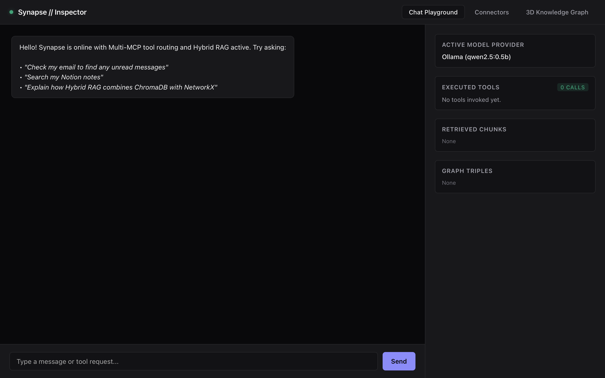
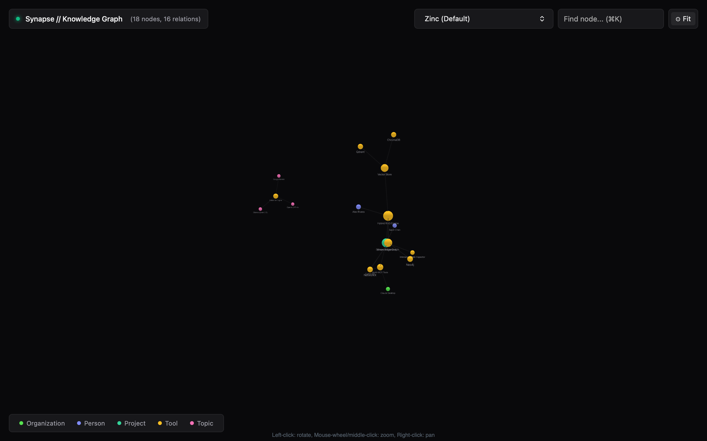
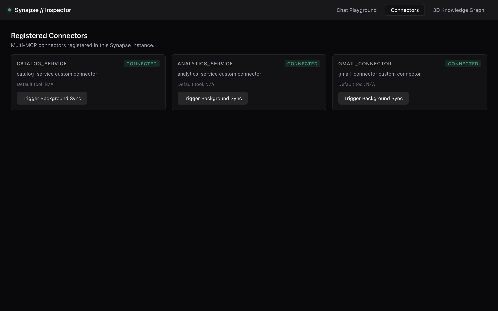
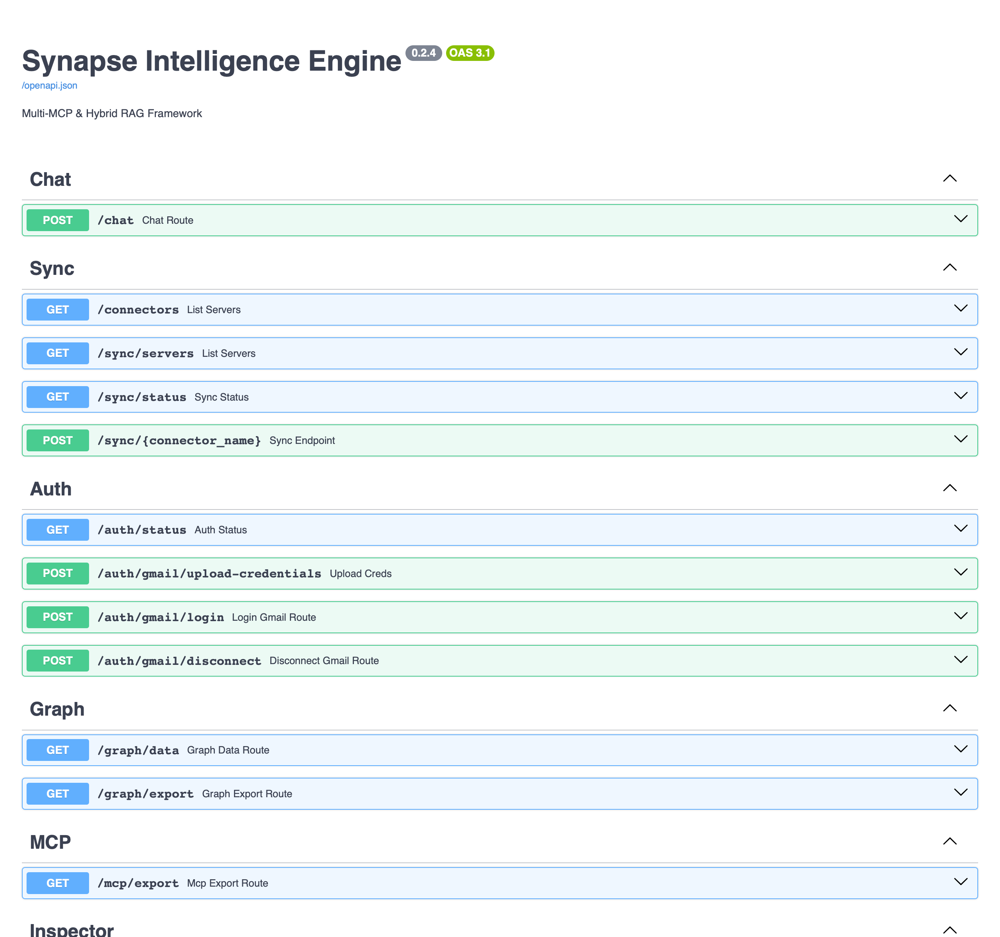
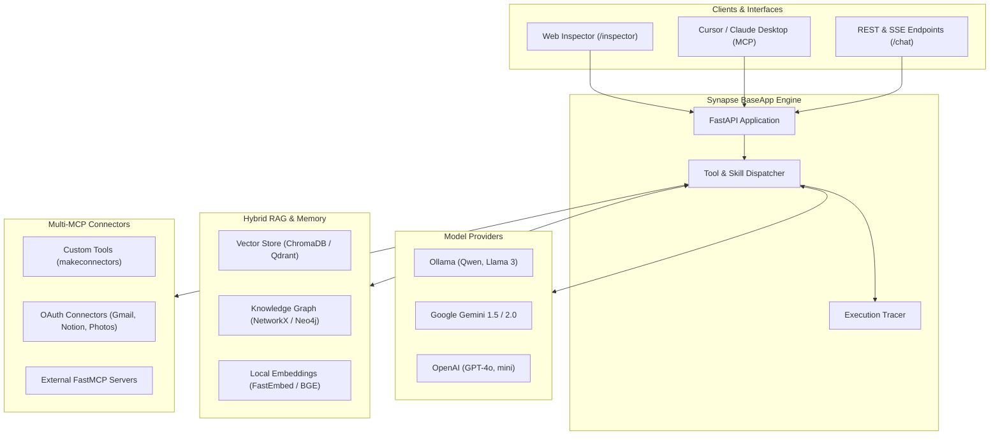

<p align="center">
  
</p>

<h1 align="center">Synapse</h1>

<p align="center">
  <b>Modular Multi-MCP & Hybrid RAG AI Application Framework</b>
</p>

<p align="center">
  <a href="https://pypi.org/project/synapse-framework/"></a>
  <a href="https://pypi.org/project/synapse-framework/"></a>
  <a href="https://github.com/AKASH-KUMAR-BARPANDA/synapse-framework/blob/main/LICENSE"></a>
  <a href="https://github.com/AKASH-KUMAR-BARPANDA/synapse-framework/actions"></a>
  <a href="https://github.com/PyCQA/bandit"></a>
</p>

<p align="center">
  <a href="#-10-line-quickstart">10-Line Demo</a> •
  <a href="#-complete-ai-backend-example">Enterprise App</a> •
  <a href="#-apprun-vs-connrun_mcp">app.run vs conn.run_mcp</a> •
  <a href="#-standalone-mcp-tool-server-connrun_mcp">Standalone MCP</a> •
  <a href="#-interactive-inspector--3d-graph">Inspector & Graph</a> •
  <a href="#-api-endpoint-reference">API Endpoints</a> •
  <a href="#-license">License</a>
</p>

---

**Synapse** is an open-source, local-first Python framework for developing autonomous AI assistants, multi-tool agents, and intelligent backend services. It unifies **Model Context Protocol (MCP)** tool execution, **Hybrid RAG** (vector embeddings combined with directed knowledge graphs), pluggable inference providers (**Ollama**, **Google Gemini**, **OpenAI**), and a real-time developer inspector with an interactive 3D WebGL knowledge visualizer.

> **Tip**: Synapse supports both lowercase (`from synapse import ...`) and PascalCase (`from Synapse import ...`) imports for maximum developer convenience.

---

## ⚡ Key Features

- 🔌 **Dynamic Multi-MCP Tool Orchestration** — Aggregate custom Python functions, external FastMCP servers, and cloud services into schema-validated, discoverable tool sets with automatic LLM tool routing.
- 🕸️ **Hybrid RAG (Vector + Knowledge Graph)** — Dual-channel retrieval engine pairing semantic vector search (ChromaDB, Qdrant, FastEmbed) with relation-aware multi-hop graph queries (NetworkX, Neo4j).
- 🧠 **Model Agnostic Inference** — Native support for offline local LLMs via **Ollama** (Qwen 2.5, Llama 3, Mistral) and frontier cloud models (**Google Gemini**, **OpenAI**, Groq, vLLM) with zero lock-in.
- 📊 **Real-Time Interactive Inspector** — Built-in dashboard at `/inspector` to test prompts, monitor live tool execution traces, inspect retrieved vector chunks, and explore relation facts.
- 🌐 **3D WebGL Knowledge Graph** — Standalone interactive visualizer at `/graph/export` featuring physics simulations, entity clustering, and real-time relation navigation.
- 📦 **One-Click MCP Server Export** — Run tools as standalone MCP servers (`conn.run_mcp()`) or export to Claude Desktop, Cursor, and LibreChat (`synapse export-mcp`).
- 🛡️ **Zero Vulnerabilities & High Test Coverage** — Clean 100% Bandit security audit, full type annotations, and modern Python 3.10+ async architecture.

---

## 📸 Interactive Inspector & 3D Graph

### 1. Developer Inspector Dashboard (`/inspector`)
Test chat prompts, observe schema-validated tool invocations in real time, and audit retrieved vector chunks and knowledge graph triples side-by-side:

<p align="center">
  
</p>

### 2. 3D WebGL Knowledge Graph Explorer (`/graph/export`)
Navigate and visualize complex entity relationships and multi-hop triples in an interactive 3D physics-based canvas:

<p align="center">
  
</p>

### 3. Connector & Sync Manager (`/connectors`)
Audit connected tools, check authentication status, and trigger on-demand synchronization:

<p align="center">
  
</p>

### 4. Interactive OpenAPI & Swagger Endpoints (`/docs`)
Explore and test all REST routes, SSE streams, sync triggers, and MCP export endpoints in real time:

<p align="center">
  
</p>

---

## 🏗️ Core Architecture



---

## 📦 Installation

Install `synapse-framework` using pip:

```bash
pip install synapse-framework
```

Or using `uv`:

```bash
uv add synapse-framework
```

### Optional Extras

```bash
# Add Qdrant vector database support
pip install "synapse-framework[qdrant]"

# Install all optional drivers and dependencies
pip install "synapse-framework[all]"
```

---

## 🚀 10-Line Quickstart

Get an AI assistant with custom tools running locally in just 10 lines of code:

```python
from synapse import BaseApp, makeconnectors
from synapse.models import ollama

def get_crypto_price(symbol: str) -> dict:
    """Returns the latest market price for a given cryptocurrency."""
    return {"symbol": symbol.upper(), "price_usd": 64200.0}

market_tools = makeconnectors(name="market", tools=[get_crypto_price])
app = BaseApp(title="CryptoBot", model=ollama("qwen2.5:0.5b"), connectors=[market_tools])

if __name__ == "__main__":
    app.run(port=8000)
```

Now open:
- 📊 **Inspector**: [`http://127.0.0.1:8000/inspector`](http://127.0.0.1:8000/inspector)
- 📖 **API Docs**: [`http://127.0.0.1:8000/docs`](http://127.0.0.1:8000/docs)

---

## 💼 Complete AI Backend Example

`BaseApp` gives you a production-ready, full-featured AI backend combining local inference, OAuth connectors, vector storage, and knowledge graphs:

```python
from Synapse import BaseApp
from Synapse.models import ollama
from Synapse.connectors import GmailConnectors, NotionConnectors
from Synapse.resource import Resource

# BaseApp gives you a complete, ready-to-use AI backend:
app = BaseApp(
    title="Company Intelligence Assistant",
    model=ollama(model="qwen2.5:0.5b"),                 # The brain (local or cloud)
    connectors=[GmailConnectors(), NotionConnectors()], # The tools (OAuth & Multi-MCP)
    resource=Resource("docs").add("data/faq.txt"),      # The knowledge base (Vector + Graph)
)

if __name__ == "__main__":
    app.run()  # Boots FastAPI + Web Inspector + SSE streaming + Vector DB + Graph
```

When you call `app.run()`, Synapse immediately spins up:
1. **FastAPI REST & SSE Server** on `http://127.0.0.1:8000`
2. **Interactive Web Inspector** at `/inspector` with live tool execution traces
3. **3D WebGL Knowledge Graph** at `/graph/export`
4. **Local Vector Database** (ChromaDB) with indexed resources
5. **Streaming Chat Endpoint** at `POST /chat` with automatic RAG grounding

---

## ⚖️ `app.run()` vs `conn.run_mcp()`

Synapse supports two fundamental deployment paradigms depending on your target architecture:

| Feature | `app.run()` (Full AI Application) | `conn.run_mcp()` (Standalone Tool Server) |
| :--- | :--- | :--- |
| **Primary Goal** | Complete AI assistant service with brain & storage | Expose custom Python tools to Claude Desktop / Cursor |
| **Brain / LLM** | Orchestrates local Ollama, Gemini, or OpenAI | None needed (Host client like Claude acts as the brain) |
| **Transport** | HTTP REST & Server-Sent Events (SSE) | Standard I/O (`stdio`) or SSE via FastMCP |
| **Developer UI** | Built-in Web Inspector (`/inspector`) & 3D Graph | Client's own native interface |
| **Knowledge Base** | Ingests documents into Hybrid RAG | Tools only (or resources attached to MCP) |
| **How to run** | `app.run(host="127.0.0.1", port=8000)` | `conn.run_mcp(transport="stdio")` |

---

## 🔌 Standalone MCP Tool Server (`conn.run_mcp()`)

If you **only want to export tools** as a dedicated Model Context Protocol (MCP) server—without running a full web server or LLM—use `conn.run_mcp()`:

```python
from synapse.connectors import makeconnectors

def search_database(query: str, limit: int = 5) -> dict:
    """Searches internal database for relevant records matching query."""
    return {"results": [{"id": 101, "record": f"Match for {query}", "score": 0.94}]}

def calculate_discount(price: float, percentage: float) -> dict:
    """Calculates discounted price and tax."""
    return {"discounted_price": round(price * (1 - percentage / 100), 2)}

# Create standalone connector (supports list or dict of tools)
conn = makeconnectors(
    name="my_tools",
    tools={"search": search_database, "discount": calculate_discount},
)

if __name__ == "__main__":
    # Boots as a standard FastMCP server over stdio
    conn.run_mcp()
```

### Connect to Claude Desktop or Cursor
In your `claude_desktop_config.json`:

```json
{
  "mcpServers": {
    "my_tools": {
      "command": "python",
      "args": ["path/to/your_mcp_script.py"]
    }
  }
}
```

### Prebuilt OAuth Productivity Connectors
Synapse includes managed OAuth 2.0 lifecycle helpers for standard productivity apps:

```python
from synapse.oauth import GoogleOAuthService
from synapse.connectors import GmailConnectors, GooglePhotosConnectors, NotionConnectors

oauth = GoogleOAuthService(
    credentials_path="credentials.json",
    token_path="token.json",
)

gmail = GmailConnectors(oauth_service=oauth)
photos = GooglePhotosConnectors(oauth_service=oauth)
notion = NotionConnectors(api_key="secret_notion_key")
```

---

## 📚 Knowledge Base & Ingestion (`Resource`)

Ingest text, single files, or entire directories into the Hybrid RAG engine with fluid method chaining:

```python
from pathlib import Path
from synapse.resource import Resource

# 1. Create a named resource collection
docs = Resource("company_knowledge")

# 2. Add files, raw text, or entire directories
docs.add("data/faq.txt")
docs.add("README.md", "docs/architecture.md")
docs.add("Company founded in 2024 specializing in agentic AI.", title="Company History")
docs.add(Path("docs/"))

# 3. Pass to BaseApp for automatic vector embedding and knowledge graph linking
app = BaseApp(
    model=ollama("qwen2.5:0.5b"),
    resource=docs,
)
```

---

## 🧠 Pluggable Model Providers

Synapse offers unified model abstractions with automatic prompt formatting and tool calling normalization:

### 1. Local Ollama (Offline / Private)
```python
from synapse.models import Ollama

model = Ollama(
    model="qwen2.5:0.5b",
    base_url="http://localhost:11434",
    temperature=0.2,
)
```

### 2. Google Gemini
```python
import os
from synapse.models import Gemini

model = Gemini(
    api_key=os.getenv("GEMINI_API_KEY"),
    model="gemini-1.5-flash",
)
```

### 3. OpenAI / Groq / OpenRouter / vLLM
```python
import os
from synapse.models import OpenAI

model = OpenAI(
    api_key=os.getenv("OPENAI_API_KEY"),
    model="gpt-4o-mini",
)
```

---

## 🕸️ Hybrid RAG & Knowledge Graph

Synapse pairs dense semantic similarity with relational graph reasoning:

```python
from synapse.storage import PersistentGraphStore, VectorStore
from synapse.rag import HybridRAG

# 1. Initialize persistent storage layers
graph_store = PersistentGraphStore(filepath="./data/graph.json")
vector_store = VectorStore(persist_dir="./data/chroma_db")

# 2. Add relational facts to knowledge graph
graph_store.add_relation("Alice", "LEADS", "Platform Engineering", source_type="Person", target_type="Organization")
graph_store.add_relation("Platform Engineering", "MAINTAINS", "Synapse Framework", source_type="Organization", target_type="Project")

# 3. Query combined knowledge base
rag = HybridRAG(vector_store=vector_store, graph_store=graph_store)
result = rag.retrieve_context("What does Alice lead?")

print("Entities found:", result["entities_detected"])
print("Graph facts:", result["graph_facts"])
```

---

## 🌐 API Endpoint Reference

Synapse automatically mounts standard REST, Server-Sent Events (SSE), and documentation endpoints on your application:

| Method | Endpoint | Tag | Description |
| :--- | :--- | :--- | :--- |
| `GET` | **`/`** or **`/inspector`** | `Inspector` | Interactive Web Inspector dashboard for chat, trace inspection, and tools. |
| `POST` | **`/chat`** | `Chat` | Server-Sent Events (SSE) streaming endpoint for agent prompts, tool calls, and grounded replies. |
| `GET` | **`/graph/export`** | `Graph` | Full-screen interactive 3D WebGL knowledge graph visualizer. |
| `GET` | **`/graph/data`** | `Graph` | JSON payload containing all graph nodes, directed links, color tokens, and stats. |
| `GET` | **`/connectors`** | `Sync` | Lists all registered connectors, descriptions, and active tools. |
| `POST` | **`/sync/{connector_name}`** | `Sync` | Triggers background synchronization and indexing for a specific connector. |
| `GET` | **`/sync/status`** | `Sync` | Returns current synchronization progress, item counts, and timestamps. |
| `GET` | **`/mcp/export`** | `MCP` | Exports active tools into Claude Desktop config format and FastMCP manifests. |
| `GET` | **`/skills`** | `Skills` | Returns registered agent skills and specialized system instructions. |
| `GET` | **`/resources`** | `Resources` | Lists static reference documents and indexed data resources. |
| `GET` | **`/info`** | `Inspector` | Overview of running model provider, connector count, and framework version. |
| `GET` | **`/health`** | `System` | Health check endpoint returning status and uptime. |
| `GET` | **`/docs`** | `Docs` | Interactive Swagger / OpenAPI documentation with try-it-out capabilities. |

---

## 🛠️ Claude Desktop & Cursor Export

Export your application tools directly to Claude Desktop or Cursor via CLI:

```bash
# Export config file
synapse export-mcp --output claude_desktop_config.json
```

Add the configuration block into your `claude_desktop_config.json`:

```json
{
  "mcpServers": {
    "synapse": {
      "command": "python",
      "args": ["-m", "synapse.export.mcp_server", "--port", "8000"]
    }
  }
}
```

---

## 🧪 Testing & Code Quality

Synapse is built with strict code quality and security verification:

```bash
# Run pytest test suite (23 unit tests)
pytest tests/

# Run security static analysis (0 vulnerabilities)
bandit -r synapse

# Check code formatting and modern standards
ruff check synapse/
```

---

## 📄 License

Synapse is licensed under the [MIT License](LICENSE).
