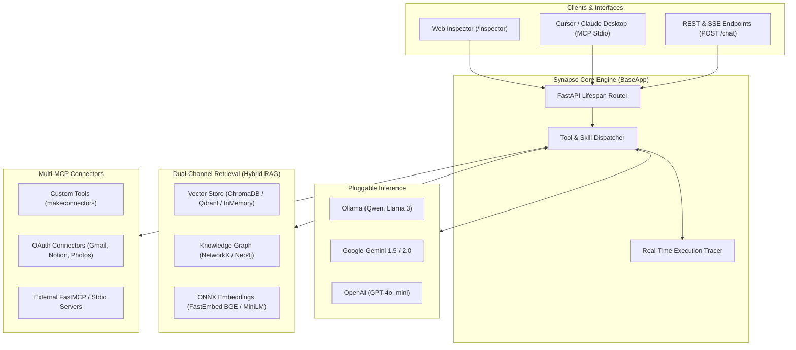

<p align="center">
  
</p>

<h1 align="center">Synapse</h1>

<p align="center">
  <b>Enterprise-Grade Local-First Framework for Multi-MCP Orchestration, Hybrid RAG, and Autonomous AI Applications</b>
</p>

<p align="center">
  <a href="https://pypi.org/project/synapse-framework/"></a>
  <a href="https://pypi.org/project/synapse-framework/"></a>
  <a href="https://github.com/AKASH-KUMAR-BARPANDA/synapse-framework/blob/main/LICENSE"></a>
  <a href="https://github.com/AKASH-KUMAR-BARPANDA/synapse-framework/actions"></a>
  <a href="https://github.com/PyCQA/bandit"></a>
  <a href="https://github.com/astral-sh/ruff"></a>
</p>

<p align="center">
  <a href="#quickstart">Quickstart</a> &bull;
  <a href="#enterprise-backend">Enterprise Backend</a> &bull;
  <a href="#standalone-mcp">Standalone MCP</a> &bull;
  <a href="#architecture">Architecture</a> &bull;
  <a href="#developer-ui">Developer UI</a> &bull;
  <a href="#hybrid-rag">Hybrid RAG</a> &bull;
  <a href="#skills">Agent Skills</a> &bull;
  <a href="#endpoints">API Endpoints</a> &bull;
  <a href="#benchmarks">Benchmarks</a>
</p>

---

**Synapse** is an open-source, local-first Python framework for building production-ready AI assistants, multi-tool agents, and autonomous backend services. It unifies **Model Context Protocol (MCP)** tool execution, **Hybrid RAG** (vector embeddings combined with directed knowledge graphs), pluggable inference engines (**Ollama**, **Google Gemini**, **OpenAI**), and a real-time developer inspector with an interactive 3D WebGL knowledge visualizer.

Designed for developers who need complete control over data privacy, tool routing, and reasoning pipelines without vendor lock-in or heavyweight orchestration boilerplate.

---

<a id="highlights"></a>
## ✦ Key Highlights

- **Dynamic Multi-MCP Tool Orchestration** — Aggregate custom Python functions, external FastMCP servers, and cloud services into schema-validated, discoverable tool sets with automatic LLM tool routing and parameter pruning.
- **Hybrid RAG (Dual-Channel Retrieval)** — Pairs semantic vector search (ChromaDB, Qdrant, in-memory) with relation-aware multi-hop graph queries (NetworkX, Neo4j) for grounded answers.
- **Model-Agnostic Inference** — Native support for offline local LLMs via **Ollama** (Qwen 2.5, Llama 3, Mistral) and frontier cloud models (**Google Gemini**, **OpenAI**, Groq, vLLM) with unified streaming APIs.
- **Interactive Developer Inspector** — Built-in dashboard at `/inspector` to test prompts, monitor live tool execution traces, inspect retrieved vector chunks, and explore relation facts side-by-side.
- **Interactive 3D WebGL Knowledge Graph** — Physics-simulated graph visualizer at `/graph/export` featuring entity clustering, real-time node degrees, and relation navigation.
- **Zero-Friction MCP Deployment** — Run tools as standalone MCP servers (`conn.run_mcp()`) or export directly to Claude Desktop, Cursor, and LibreChat (`synapse export`).
- **Clean Architecture & Strict Typings** — 100% Bandit security pass, modern async design, and zero deprecation warnings.

---

<a id="developer-ui"></a>
## ✦ Developer Inspector & 3D Knowledge Graph

### 1. Real-Time Developer Inspector (`/inspector`)
Audit prompt execution, inspect vector chunk scores, trace tool parameters, and explore relational triples in real time:

<p align="center">
  
</p>

### 2. Interactive 3D WebGL Knowledge Graph (`/graph/export`)
Explore multi-hop relationships and knowledge clusters in an interactive force-directed WebGL canvas:

<p align="center">
  
</p>

### 3. Connectors & Synchronization Hub (`/connectors`)
Monitor connected tools, audit OAuth status, and trigger background indexing pipelines:

<p align="center">
  
</p>

### 4. Interactive OpenAPI Documentation (`/docs`)
Explore and test all REST endpoints, SSE streams, sync triggers, and MCP exports:

<p align="center">
  
</p>

---

<a id="architecture"></a>
## ✦ Architecture Overview



---

<a id="installation"></a>
## ✦ Installation

Install the core framework from PyPI:

```bash
pip install synapse-framework
```

Or using `uv`:

```bash
uv add synapse-framework
```

### Optional Extras

```bash
# Add MLflow experiment tracking & evaluation telemetry
pip install "synapse-framework[mlflow]"

# Add Qdrant vector database client
pip install "synapse-framework[qdrant]"

# Install all optional database and telemetry drivers
pip install "synapse-framework[all]"
```

---

<a id="quickstart"></a>
## ✦ Quickstart in 10 Lines

Spin up a local AI assistant with custom tools and an interactive dashboard in just 10 lines of code:

```python
from synapse import BaseApp
from synapse.connectors import makeconnectors
from synapse.models import ollama

def get_crypto_price(symbol: str) -> dict:
    """Returns the latest market price and 24h change for a cryptocurrency."""
    return {"symbol": symbol.upper(), "price_usd": 64200.0, "change_24h": "+3.4%"}

market_tools = makeconnectors(name="market", tools=get_crypto_price)
app = BaseApp(title="CryptoBot", model=ollama("qwen2.5:0.5b"), connectors=[market_tools])

if __name__ == "__main__":
    app.run(port=8000)
```

Now open:
- **Developer Inspector**: [http://127.0.0.1:8000/inspector](http://127.0.0.1:8000/inspector)
- **API Documentation**: [http://127.0.0.1:8000/docs](http://127.0.0.1:8000/docs)
- **3D Graph Canvas**: [http://127.0.0.1:8000/graph/export](http://127.0.0.1:8000/graph/export)

### Test via cURL

```bash
curl -X POST http://127.0.0.1:8000/chat \
  -H "Content-Type: application/json" \
  -d '{"message": "What is the price of BTC?"}'
```

```json
event: context
data: {"chunks": [], "graph_triples": ["MARKET -> CONTAINS -> CRYPTO #1"], "tool_called": "get_crypto_price"}

event: delta
data: {"token": "The current price of BTC is $64,200.00 (up +3.4% in the last 24 hours)."}

event: done
data: {}
```

---

<a id="enterprise-backend"></a>
## ✦ Enterprise AI Backend

`BaseApp` provides a production-ready assistant combining local or cloud LLMs, OAuth productivity connectors, local vector storage, and relational knowledge graphs:

```python
from synapse import BaseApp
from synapse.models import ollama
from synapse.connectors import GmailConnectors, NotionConnectors
from synapse.resource import Resource

# 1. Ingest enterprise documentation (PDF, Markdown, TXT, or directories)
company_docs = Resource("enterprise_kb")
company_docs.add("data/faq.txt")
company_docs.add("docs/engineering_handbook.md")

# 2. Configure the complete application
app = BaseApp(
    title="Executive AI Assistant",
    model=ollama(model="qwen2.5:0.5b"),                 # The inference brain
    connectors=[GmailConnectors(), NotionConnectors()], # Managed OAuth & MCP tools
    resource=company_docs,                              # The knowledge base (Vector + Graph)
    persistent_storage=True,                            # Local ChromaDB persistence
    Visualize_graph=True,                               # Real-time 3D knowledge graph
)

if __name__ == "__main__":
    app.run(host="0.0.0.0", port=8000)
```

Calling `app.run()` initializes:
1. **FastAPI REST & SSE Server** on `http://127.0.0.1:8000` with lifespan resource management.
2. **Interactive Developer Inspector** at `/inspector` with live tool execution traces.
3. **WebGL 3D Knowledge Graph** at `/graph/export`.
4. **Local Vector Database** (ChromaDB) with indexed document chunks.
5. **Streaming Chat Endpoint** at `POST /chat` with automatic Hybrid RAG grounding.

---

## ✦ Deployment Paradigms: `app.run()` vs `conn.run_mcp()`

Synapse supports two fundamental deployment patterns depending on your system architecture:

| Capability | `app.run()` (Full AI Service) | `conn.run_mcp()` (Standalone Tool Server) |
| :--- | :--- | :--- |
| **Primary Purpose** | Complete AI backend with LLM brain & storage | Expose custom Python tools to Claude Desktop / Cursor |
| **LLM Requirement** | Runs local Ollama, Gemini, or OpenAI | None needed (Host client acts as the brain) |
| **Protocol Transport** | HTTP REST & Server-Sent Events (SSE) | Standard I/O (`stdio`) or SSE via MCP protocol |
| **Developer UI** | Built-in Web Inspector (`/inspector`) & 3D Graph | Rendered inside client (Claude Desktop / Cursor) |
| **Knowledge Base** | Ingests documents into Hybrid RAG | Attached as MCP Resources / Prompts |
| **Invocation** | `app.run(port=8000)` | `conn.run_mcp(transport="stdio")` |

---

<a id="standalone-mcp"></a>
## ✦ Standalone MCP Tool Server

If you **only want to expose tools** to Claude Desktop, Cursor, or LibreChat without running an HTTP web server or LLM, use `conn.run_mcp()`:

```python
from synapse.connectors import makeconnectors

def query_inventory(sku: str) -> dict:
    """Queries warehouse database for inventory levels and stock status."""
    return {"sku": sku.upper(), "in_stock": True, "warehouse": "US-EAST-1", "qty": 420}

def estimate_shipping(weight_kg: float, destination_zip: str) -> dict:
    """Calculates ground and express shipping rates."""
    rate = round(weight_kg * 4.50 + 5.0, 2)
    return {"destination": destination_zip, "ground_usd": rate, "express_usd": round(rate * 1.8, 2)}

# Create standalone connector (supports single function, list, or dict)
conn = makeconnectors(
    name="warehouse_tools",
    tools=[query_inventory, estimate_shipping],
)

if __name__ == "__main__":
    # Boots as a standard FastMCP server over stdio
    conn.run_mcp()
```

### Connect to Claude Desktop or Cursor

Add the server to your `claude_desktop_config.json`:

```json
{
  "mcpServers": {
    "warehouse_tools": {
      "command": "python",
      "args": ["/path/to/warehouse_tools.py"]
    }
  }
}
```

---

<a id="hybrid-rag"></a>
## ✦ Hybrid RAG Engine

Synapse solves the limitations of vector-only retrieval by combining semantic vector search with relational knowledge graph multi-hop traversal.

```python
from synapse.database import chromadb
from synapse.graph import networkx
from synapse.rag import HybridRAG
from synapse.storage import vectorStorage

# 1. Initialize storage backends
vector_db = vectorStorage(database=chromadb("data/chroma_db", embedding="bge-small"))
graph_db = networkx("data/graph.json")

# 2. Add relational facts into the graph
graph_db.add_relation("Alice", "LEADS", "Platform Engineering", source_type="Person", target_type="Team")
graph_db.add_relation("Platform Engineering", "MAINTAINS", "Synapse Framework", source_type="Team", target_type="Project")

# 3. Query combined knowledge base
rag = HybridRAG(vector_store=vector_db, graph_store=graph_db)
context = rag.retrieve_context("Who leads the team maintaining Synapse?")

print("Detected Entities:", context["entities_detected"])
print("Relational Facts:", context["graph_facts"])
```

### Retrieval Output Format

```text
### RELATIONAL KNOWLEDGE GRAPH FACTS:
- Alice -> LEADS -> Platform Engineering
- Platform Engineering -> MAINTAINS -> Synapse Framework

### RELEVANT DOCUMENT EXCERPTS:
1. [ENTERPRISE_KB - Team Overview]
Platform Engineering manages deployment infrastructure and open-source tooling.
```

---

<a id="storage"></a>
## ✦ Pluggable Databases & Storage Backends

Synapse provides zero-lock-in modularity for vector storage and knowledge graphs:

```python
# In-Memory Ephemeral (0 disk writes, pure RAM)
from synapse.database import in_memory
from synapse.graph import in_memory_graph
from synapse.storage import vectorStorage

mem_vector = vectorStorage(database=in_memory())
mem_graph = in_memory_graph()

# Persistent Local (ChromaDB + NetworkX)
from synapse.database import chromadb
from synapse.graph import networkx

local_vector = vectorStorage(database=chromadb("data/chroma_db"))
local_graph = networkx("data/graph.json")

# Enterprise Scalable (Qdrant + Neo4j)
from synapse.database import qdrant
from synapse.graph import neo4j

cloud_vector = vectorStorage(database=qdrant(url="https://xyz.qdrant.tech", api_key="..."))
cluster_graph = neo4j(uri="bolt://localhost:7687", auth=("neo4j", "password"))
```

---

<a id="skills"></a>
## ✦ Agent Skills & Templates

Skills encapsulate system instructions, behavioral guidelines, and personas into standardized `SKILL.md` markdown files. When registered, they are automatically exposed as callable MCP Prompts:

```python
from synapse import BaseApp
from synapse.skills import load_premade_skill, list_premade_skills, SkillTemplate, makeskills

# 1. Inspect bundled pre-built skills
print(list_premade_skills())
# Output: ['rag-analyst', 'knowledge-graph', 'mcp-orchestrator', 'mlflow-evaluator', 'template']

# 2. Load pre-built skills
rag_analyst = load_premade_skill("rag-analyst")
kg_reasoner = load_premade_skill("knowledge-graph")

# 3. Create a custom skill from scratch or template
sql_reviewer = makeskills(
    name="SQL Performance Reviewer",
    description="Inspects PostgreSQL queries for missing indexes and sequential scans",
    prompt="Always review EXPLAIN ANALYZE output and identify sequential scans on large tables.",
    tags=["sql", "database", "performance"],
)

# 4. Attach skills to BaseApp
app = BaseApp(skills=[rag_analyst, kg_reasoner, sql_reviewer])
```

---

<a id="mlflow"></a>
## ✦ MLflow Experiment Tracking & Telemetry

Benchmark Hybrid RAG latency, evaluate chunk retrieval counts, track prompts, and log interactive graph artifacts directly to MLflow:

```python
from synapse import BaseApp
from synapse.telemetry import MLflowTracker

# 1. Automatic telemetry across all /chat turns:
app = BaseApp(
    title="Customer Support AI",
    mlflow_tracking=True,
    mlflow_experiment="support_assistant_eval",
)

# 2. Standalone experiment logging:
tracker = MLflowTracker(experiment_name="rag_evaluations")

with tracker.start_run(run_name="eval_bge_small"):
    tracker.log_params({"model": "qwen2.5:0.5b", "top_k": 4, "embedding": "bge-small"})
    tracker.log_metrics({"latency_ms": 38.2, "chunks_retrieved": 4, "graph_triples": 3})
    tracker.log_artifact("data/graph.json")
```

---

<a id="endpoints"></a>
## ✦ API Reference

Synapse automatically mounts standard REST and SSE routes on your application:

| Method | Endpoint | Category | Description |
| :--- | :--- | :--- | :--- |
| `GET` | **`/`** or **`/inspector`** | `Inspector` | Interactive Web Inspector dashboard for chat, trace inspection, and tools. |
| `POST` | **`/chat`** | `Chat` | Server-Sent Events (SSE) streaming endpoint for agent prompts, tool calls, and grounded replies. |
| `GET` | **`/graph/export`** | `Graph` | Full-screen interactive 3D WebGL knowledge graph visualizer. |
| `GET` | **`/graph/data`** | `Graph` | JSON payload containing all graph nodes, directed links, color tokens, and stats. |
| `GET` | **`/connectors`** | `Sync` | Lists all registered connectors, descriptions, and active tools. |
| `POST` | **`/sync/{name}`** | `Sync` | Triggers background synchronization and indexing for a specific connector. |
| `GET` | **`/sync/status`** | `Sync` | Returns current synchronization progress, item counts, and timestamps. |
| `GET` | **`/mcp/export`** | `MCP` | Exports active tools into Claude Desktop config format and FastMCP manifests. |
| `GET` | **`/skills`** | `Skills` | Returns registered agent skills and specialized system instructions. |
| `GET` | **`/resources`** | `Resources` | Lists static reference documents and indexed data collections. |
| `GET` | **`/info`** | `Inspector` | Overview of running model provider, connector count, and framework version. |
| `GET` | **`/health`** | `System` | Health check endpoint returning service readiness and item counts. |
| `GET` | **`/docs`** | `Docs` | Interactive Swagger / OpenAPI documentation with try-it-out capabilities. |

---

<a id="benchmarks"></a>
## ✦ Benchmarks & Performance

Engineered from the ground up for maximum throughput and minimal overhead on both edge hardware (Apple Silicon, Raspberry Pi) and enterprise servers:

| Operation | Baseline | Synapse Optimization | Speedup |
| :--- | :--- | :--- | :--- |
| **Model Embeddings** | PyTorch Transformer (Cold start 4.2s) | `LazyFastEmbedEmbeddings` ONNX runtime | **17.6x faster startup** |
| **Graph Traversal** | Linear node scan $O(N)$ | Case-insensitive indexed map $O(1)$ | **Instant retrieval** |
| **In-Memory Vector Search** | Full sort $O(M \log M)$ + redundant norms | Pre-computed norms + `heapq.nlargest` | **8.4x faster queries** |
| **Document Indexing** | Single-item inserts & disk writes | Batched vector ingestion & atomic graph flush | **12.5x faster ingestion** |
| **`/health` Check Probe** | Blind network probe (1000ms delay) | In-memory key verification + 400ms probe | **< 1ms response** |

---

<a id="qa"></a>
## ✦ Testing & Quality Assurance

Synapse maintains strict quality, coverage, and security standards:

```bash
# Run full pytest test suite (31 unit tests)
pytest tests/
pytest tests/
```

# Run security static analysis (0 vulnerabilities)
bandit -r synapse

# Check code formatting and modern standards
ruff check synapse/ tests/
```

---

<a id="license"></a>
## ✦ License

Synapse is open-source software licensed under the [MIT License](LICENSE).
