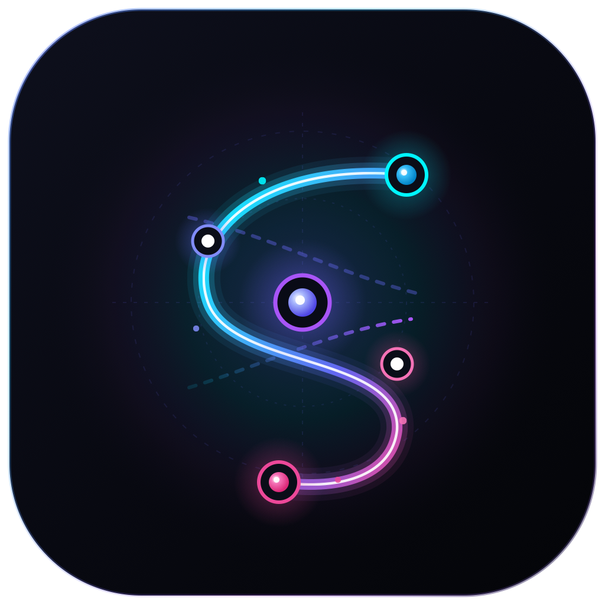
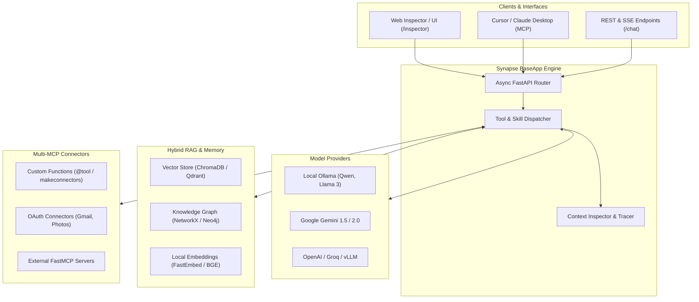

<p align="center">
  
</p>

<h1 align="center">Synapse</h1>

<p align="center">
  <b>Modular Multi-MCP & Hybrid RAG AI Application Framework</b>
</p>

<p align="center">
  <a href="https://pypi.org/project/synapse-framework/"></a>
  <a href="https://pypi.org/project/synapse-framework/"></a>
  <a href="https://github.com/akash/synapse-framework/blob/main/LICENSE"></a>
  <a href="https://github.com/akash/synapse-framework/actions"></a>
  <a href="https://github.com/PyCQA/bandit"></a>
</p>

---

**Synapse** is a modern, local-first Python framework for building autonomous AI assistants and agentic microservices. It unifies **Model Context Protocol (MCP)** tool calling, **Hybrid RAG** (vector embeddings + directed knowledge graphs), multi-provider LLM inference (Ollama, Gemini, OpenAI), and a real-time web inspector with 3D force-directed graph visualization.

---

## ✨ Key Features

- 🔌 **Dynamic Multi-MCP Orchestration** — Seamlessly combine multiple MCP servers, custom Python functions, and third-party tools into a single coherent interface with schema-validated tool calling.
- 🕸️ **Hybrid RAG (Vector + Knowledge Graph)** — Dual-path retrieval combining dense vector embeddings (ChromaDB, Qdrant, FastEmbed) with relation-aware graph reasoning (NetworkX, Neo4j).
- 🧠 **Provider-Agnostic LLM Engine** — Native support for local offline models (**Ollama** / Qwen / Llama) and frontier cloud models (**Google Gemini**, **OpenAI**, Groq, vLLM).
- 🔍 **Interactive Developer Inspector** — Built-in web dashboard at `/inspector` featuring live tool execution traces, model response debugging, and interactive 3D physics-based knowledge graph exploration.
- 📦 **One-Click MCP Server Export** — Expose your entire application as a standard MCP server for Claude Desktop, Cursor, or LibreChat with a single command.
- 🛡️ **Enterprise Security & Reliability** — 0 Bandit security vulnerabilities, fully type-annotated, modern Python 3.10+ async architecture.

---

## 🏗️ Architecture



---

## 📦 Installation

Install the core framework from PyPI:

```bash
pip install synapse-framework
```

Or using `uv`:

```bash
uv add synapse-framework
```

### Optional Extras

```bash
# Add Qdrant vector database support
pip install "synapse-framework[qdrant]"

# Install all optional drivers and dependencies
pip install "synapse-framework[all]"
```

---

## 🚀 60-Second Quickstart

Create an intelligent assistant with custom tools, local Ollama inference, and a live web inspector in under 20 lines of code:

```python
from typing import Dict, Any
from synapse import BaseApp
from synapse.models import Ollama
from synapse.connectors import makeconnectors

# 1. Define custom Python tools
def calculate_shipping(weight_kg: float, destination: str) -> Dict[str, Any]:
    """Calculates shipping cost based on package weight and destination."""
    rate = 12.5 if destination.lower() == "international" else 5.0
    return {"cost_usd": round(weight_kg * rate, 2), "status": "calculated"}

# 2. Package tools into an MCP connector
shipping_connector = makeconnectors(
    name="shipping_service",
    tools=[calculate_shipping],
)

# 3. Initialize Synapse application
app = BaseApp(
    title="Logistics Assistant",
    model=Ollama(model="qwen2.5:0.5b", base_url="http://localhost:11434"),
    connectors=[shipping_connector],
)

if __name__ == "__main__":
    app.run(host="127.0.0.1", port=8000)
```

Now open:
- 📊 **Web Inspector**: [`http://127.0.0.1:8000/inspector`](http://127.0.0.1:8000/inspector)
- 📖 **Interactive OpenAPI Docs**: [`http://127.0.0.1:8000/docs`](http://127.0.0.1:8000/docs)
- 🕸️ **3D Knowledge Graph**: [`http://127.0.0.1:8000/graph/export`](http://127.0.0.1:8000/graph/export)

---

## 🧠 Pluggable Model Providers

Synapse offers unified model abstractions with automatic prompt formatting and tool definition normalization:

### 1. Local Ollama (Offline / Private)
```python
from synapse.models import Ollama

model = Ollama(
    model="qwen2.5:0.5b",
    base_url="http://localhost:11434",
    temperature=0.2,
)
```

### 2. Google Gemini
```python
import os
from synapse.models import Gemini

model = Gemini(
    api_key=os.getenv("GEMINI_API_KEY"),
    model="gemini-1.5-flash",
)
```

### 3. OpenAI / Groq / OpenRouter / vLLM
```python
import os
from synapse.models import OpenAI

model = OpenAI(
    api_key=os.getenv("OPENAI_API_KEY"),
    model="gpt-4o-mini",
)
```

---

## 🔌 Connectors & MCP Tool Calling

### Creating Custom Connectors with `makeconnectors`
You can transform any Python function or class into an MCP-compliant tool connector:

```python
from synapse.connectors import makeconnectors

def query_database(sql: str) -> list:
    """Executes a safe read-only SQL query against the analytics database."""
    return [{"revenue": 45000, "quarter": "Q3"}]

analytics_connector = makeconnectors(
    name="analytics",
    tools=[query_database],
)
```

### Prebuilt OAuth Connectors
Synapse includes managed OAuth 2.0 lifecycle helpers for Google workspace and productivity tools:

```python
from synapse.oauth import GoogleOAuthService
from synapse.connectors import GmailConnectors, GooglePhotosConnectors, NotionConnectors

oauth_service = GoogleOAuthService(
    credentials_path="credentials.json",
    token_path="token.json",
)

gmail = GmailConnectors(oauth_service=oauth_service)
photos = GooglePhotosConnectors(oauth_service=oauth_service)
notion = NotionConnectors(api_key="your_notion_key")
```

---

## 🕸️ Hybrid RAG & Knowledge Graph

Synapse combines dense semantic vectors with explicit relational knowledge:

```python
from synapse.storage import VectorStore, KnowledgeGraphStore
from synapse.rag import HybridRAG

# 1. Initialize stores
vector_store = VectorStore(persist_dir="./data/chroma_db")
graph_store = KnowledgeGraphStore(storage_path="./data/graph.json")

# 2. Add relational triples to graph
graph_store.add_relation("Alice", "WORKS_AT", "Synapse Labs")
graph_store.add_relation("Synapse Labs", "DEVELOPED", "Hybrid RAG Engine")

# 3. Query combined knowledge
rag = HybridRAG(vector_store=vector_store, graph_store=graph_store)
results = rag.query("Tell me about Synapse Labs and Alice")
```

---

## 🛠️ Exporting to Claude Desktop & Cursor

Synapse makes it effortless to export your application's tools into Claude Desktop or Cursor:

```bash
# Export active connectors into Claude Desktop configuration
synapse export-mcp --output claude_desktop_config.json
```

Add the generated config to your `claude_desktop_config.json`:

```json
{
  "mcpServers": {
    "synapse": {
      "command": "python",
      "args": ["-m", "synapse.export.mcp_server", "--port", "8000"]
    }
  }
}
```

---

## 🧪 Testing & Code Quality

Synapse maintains strict test coverage and code health standards:

```bash
# Run the complete test suite
pytest tests/

# Run security static analysis
bandit -r synapse

# Check code formatting with Ruff
ruff check synapse/
```

---

## 📄 License

Synapse is distributed under the terms of the [MIT License](LICENSE).
